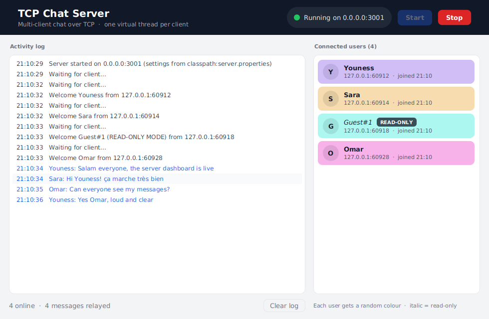
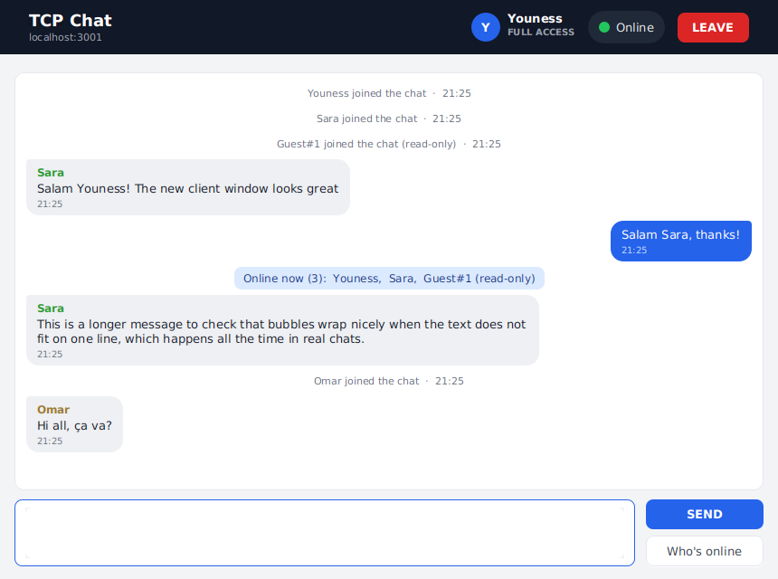
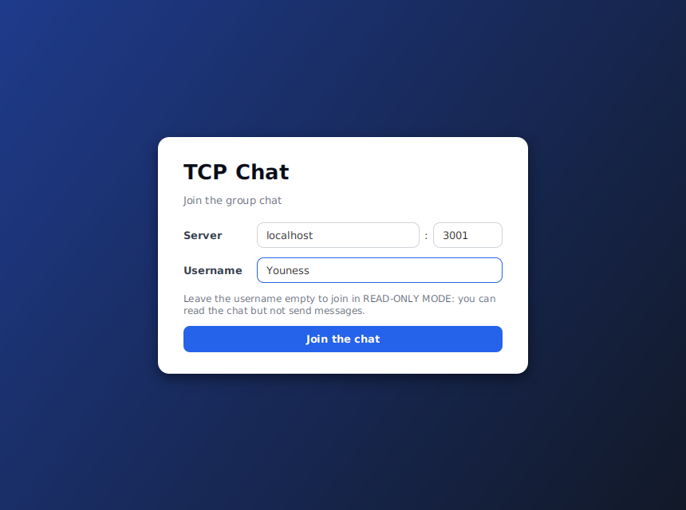
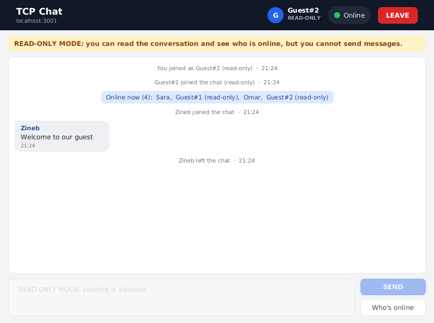
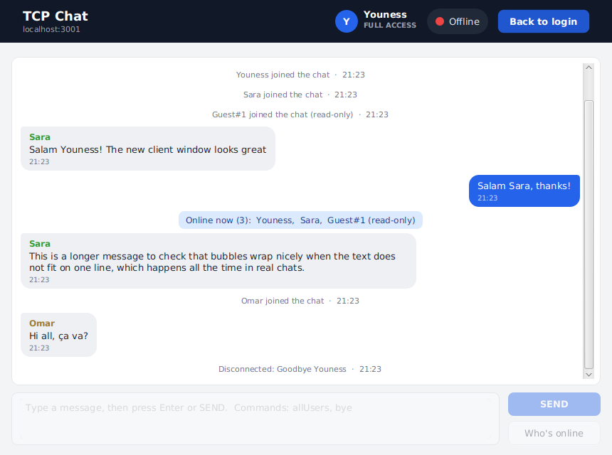
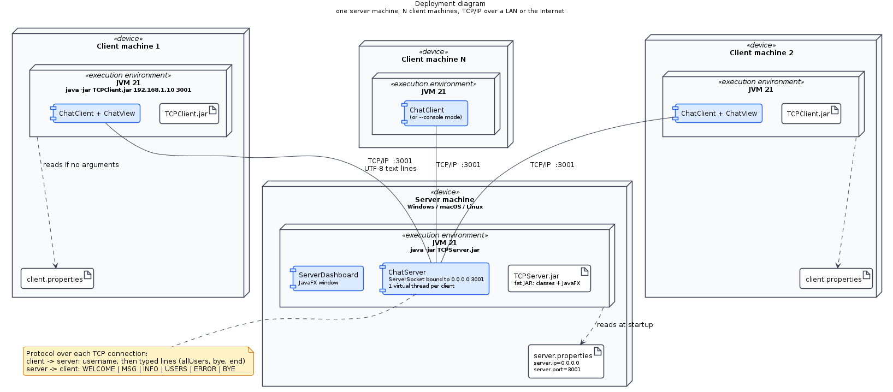
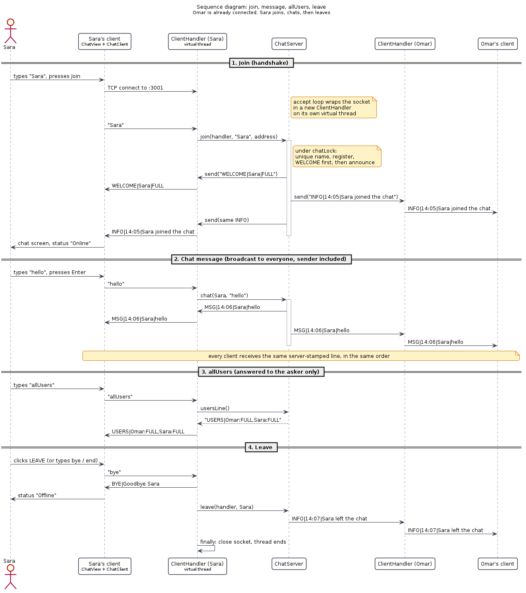

# TCP Chat: multi-client chat over Java sockets

A group chat built with **Java 21 TCP sockets**, **virtual threads** and **JavaFX**: a central server relays every message to all connected clients, stamped with the sender's name and the time.

Mini Project 1, *Advanced Paradigms* course, Al Akhawayn University (Prof. El Habib Nfaoui).

   

| Server dashboard | Client chat window |
| --- | --- |
|  |  |

---

## Contents

- [Features](#features)
- [Quick start](#quick-start)
- [Build from source](#build-from-source)
- [Configuration](#configuration)
- [Architecture](#architecture)
- [Protocol](#protocol)
- [Design decisions](#design-decisions)
- [Testing](#testing)
- [Project structure](#project-structure)
- [Known limitations](#known-limitations)

---

## Features

Every functional requirement of the specification, and where it lives:

**Client** (`chat-client`)

| Requirement | Implementation |
| --- | --- |
| Username before the chat interface | A login screen comes first; the chat screen appears only after the server's `WELCOME` |
| No username: **READ-ONLY MODE** | Amber banner, input and SEND disabled; enforced by the UI, the client model **and** the server |
| Send with a **SEND** button or **Enter** | `TextArea` + SEND; Enter is intercepted and sends |
| `allUsers` command | Typed, or the *Who's online* button: the server answers the asker only |
| Disconnect with `end`, `bye` or **LEAVE** | All three send `bye`; the server announces the departure to everyone |
| "Online" status label + visual indicator | Green circle + *Online*, red circle + *Offline* in the header |

**Server** (`chat-server`)

| Requirement | Implementation |
| --- | --- |
| Many concurrent clients | One **virtual thread** per client (`Executors.newVirtualThreadPerTaskExecutor()`) |
| Messages formatted with sender and time, sent to all | `MSG\|HH:mm\|sender\|text` broadcast to every client, sender included |
| Live ListView of connected users | JavaFX `ListView` bound to an `ObservableList` |
| Random background colour per user | Random start hue + golden-angle steps: random each run, always distinct |
| Activity log ("Server started", "Waiting for client", "Welcome ...") | Live log with chat lines in blue and errors in red |

**Technical requirements**: Java + TCP sockets, JavaFX with **GridPane** layouts and **CSS** styling, virtual threads, IP/port loaded from `.properties` files at runtime, strict Model/View separation (the model packages contain **zero** JavaFX imports), command-line arguments `java TCPClient <ServerIPAddress> <PortNumber>` and `java TCPServer`.

**Extras**: Start/Stop buttons on the server, duplicate names renamed (`Sara#2`), text mode for both apps (`--console`), launch scripts, executable JARs that run on Windows, Linux and Apple Silicon macOS.

| Login | Read-only mode | After leaving |
| --- | --- | --- |
|  |  |  |

---

## Quick start

Requirements: **Java 21** or later (`java -version`). Download `TCPServer.jar` and `TCPClient.jar` from the [Releases](../../releases) page, or [build them](#build-from-source).

```bash
# 1. Start the server (opens the dashboard; listens on port 3001)
java -jar TCPServer.jar

# 2. Start one or more clients
java -jar TCPClient.jar localhost 3001        # connect to a server on this machine
java -jar TCPClient.jar 192.168.1.20 3001     # connect to a server on your network
java -jar TCPClient.jar                       # no arguments: client.properties decides
```

In the client, type a username (or leave it empty for read-only mode) and press Enter. Commands typed in the chat: `allUsers`, `bye`, `end`.

Text mode (no GUI) for both apps:

```bash
java -jar TCPServer.jar --console              # commands: users, stop
java -jar TCPClient.jar --console localhost 3001
```

On Windows you can also double-click `run-server.bat` and `run-client.bat` (next to the JARs in `target/`).

---

## Build from source

```bash
git clone https://github.com/TeCom0/tcp-chat.git
cd tcp-chat
mvn package
```

One command builds both projects, runs the 44 tests and produces:

```
chat-server/target/TCPServer.jar   server.properties   run-server.bat / .sh
chat-client/target/TCPClient.jar   client.properties   run-client.bat / .sh
```

In IntelliJ IDEA: open the `tcp-chat` folder, then run `TCPServer` and `TCPClient` (enable *Allow multiple instances* to open several clients), or Maven panel > tcp-chat > Lifecycle > package.

---

## Configuration

Network settings are read **at runtime** from `.properties` files: change them without recompiling.

| File | Keys | Default |
| --- | --- | --- |
| `server.properties` | `server.ip` (address to listen on, `0.0.0.0` = all interfaces), `server.port` | `0.0.0.0`, `3001` |
| `client.properties` | `server.ip` (host or IP of the server), `server.port` | `localhost`, `3001` |

Lookup order, first found wins:

1. **Client only**: command-line arguments `<ServerIPAddress> <PortNumber>`
2. The file in the current working directory
3. The file next to the running JAR (`target/` after a build)
4. The copy bundled inside the JAR
5. Built-in defaults

The server's first log line says which file was used, e.g. `Server started on 0.0.0.0:3001 (settings from classpath:server.properties)`.

---

## Architecture

Both applications follow the same split: a **model** that does all networking and logic with no UI code, and **views** (JavaFX window, text console) that implement a listener interface. The model never knows which view is attached.



**Server**: an accept loop runs on a virtual thread and gives every connection its own `ClientHandler` virtual thread. All handlers share one `ChatServer`, which stamps and broadcasts messages under a single lock (`chatLock`), so every client sees the same messages in the same order. Events reach the dashboard through `ServerListener`; the dashboard moves them onto the JavaFX thread with `Platform.runLater`.

**Client**: `ChatClient` connects and performs the handshake, then a background virtual thread reads every incoming line, parses it into a typed `ServerEvent` (a sealed interface of records) and notifies `ClientListener`s. `connect()` runs off the JavaFX thread, so the window never freezes.

| Class diagrams | |
| --- | --- |
| [Server classes](docs/uml/server-classes.png) | [Client classes](docs/uml/client-classes.png) |



All diagrams are [PlantUML](https://plantuml.com) sources in [`docs/uml/`](docs/uml) (`.puml`), rendered to PNG and SVG. A [use case diagram](docs/uml/use-cases.png) is included too.

---

## Protocol

Plain UTF-8 text, one message per line.

| Direction | Line | Meaning |
| --- | --- | --- |
| client to server | `Sara` (first line) | Requested username; empty = read-only guest |
| client to server | `hello everyone` | A chat message |
| client to server | `allUsers` / `bye` / `end` | Commands (case-insensitive) |
| server to client | `WELCOME\|Sara\|FULL` | Always the first line: assigned name and mode (`FULL` or `READ_ONLY`) |
| server to client | `MSG\|14:05\|Sara\|hello everyone` | Chat message stamped by the server |
| server to client | `INFO\|14:05\|Omar joined the chat` | Join / leave notices |
| server to client | `USERS\|Sara:FULL,Guest#1:READ_ONLY` | Answer to `allUsers` (asker only) |
| server to client | `ERROR\|...` | Request refused (e.g. a read-only user sending) |
| server to client | `BYE\|reason` | The server closes the connection |

The message text is always the last field and clients split with a limit, so a `|` typed by a user survives. You can speak the protocol directly with the debug client: `python tools/raw_client.py localhost 3001`.

---

## Design decisions

Points the specification leaves open, and the choices made:

- **Arguments vs. configuration file** (spec 3.3 vs. 4.1): arguments win, then the file, then defaults.
- **"All other clients" vs. "all active connections"**: messages go to everyone, sender included, so every screen shows the same server-stamped line.
- **Read-only is enforced on the server**, not only in the UI: a raw TCP client cannot bypass it.
- **Duplicate usernames** become `Name#2`, `Name#3`... (case-insensitive); reserved characters `| , : #` are stripped.
- **One lock for registration and broadcasting**: guarantees `WELCOME` is each client's first line and a single global message order.
- **User colours are a view concern**: the server's list uses random colours, the client uses a stable colour per name.
- **Launcher classes do not extend `Application`**: otherwise a fat JAR fails with *"JavaFX runtime components are missing"*.
- **The model never imports JavaFX**: proven by the console mode, which runs the same model with no GUI.

---

## Testing

44 JUnit 5 tests, run by `mvn test` or `mvn package`:

| Project | Tests | What they cover |
| --- | --- | --- |
| chat-server | 21 | Protocol rules, configuration parsing, real-socket integration tests (handshake, broadcast, read-only refusal, `allUsers`, duplicate names, bye, crash detection, shutdown, 50 concurrent clients), colour generation |
| chat-client | 23 | Line parsing, argument/config priority, the client against a scripted fake server (routing, read-only, polite and abrupt disconnects, watchdog, reconnect safety), name colours |

The integration tests use real sockets on free ports, nothing is mocked. The client is tested against a fake server, so the two projects stay independent.

---

## Project structure

```
tcp-chat/
├─ pom.xml                       aggregator: builds both projects
├─ chat-server/                  TCPServer
│  └─ src/main/java/ma/project/chat/server/
│     ├─ TCPServer.java          entry point
│     ├─ model/                  ChatServer, ClientHandler, ServerListener, Protocol, ...
│     ├─ view/                   ServerApp, ServerDashboard, UserColors (+ server.css)
│     └─ console/                ConsoleServer
├─ chat-client/                  TCPClient
│  └─ src/main/java/ma/project/chat/client/
│     ├─ TCPClient.java          entry point
│     ├─ model/                  ChatClient, ServerEvent, ClientListener, ClientConfig, ...
│     ├─ view/                   ClientApp, LoginView, ChatView, NameColors (+ client.css)
│     └─ console/                ConsoleClient
├─ docs/uml/                     PlantUML sources + rendered diagrams
├─ docs/images/                  screenshots
└─ tools/raw_client.py           raw protocol client for debugging
```

---

## Known limitations

- **A client that stops reading can slow everyone down**: broadcasts write to each socket while holding the shared lock, so a frozen client with a full TCP buffer delays the others. The fix would be one outgoing queue per client.
- **No encryption or authentication**: traffic is plain text and anyone can pick any free name. Fine on a classroom LAN, not on the Internet.
- **No message history**: a client only sees messages sent after it joined.
- **Intel Macs** are not covered by the bundled natives (Apple Silicon, Windows and Linux are).

---

*Author: Youness ([@TeCom0](https://github.com/TeCom0)), Al Akhawayn University.*
